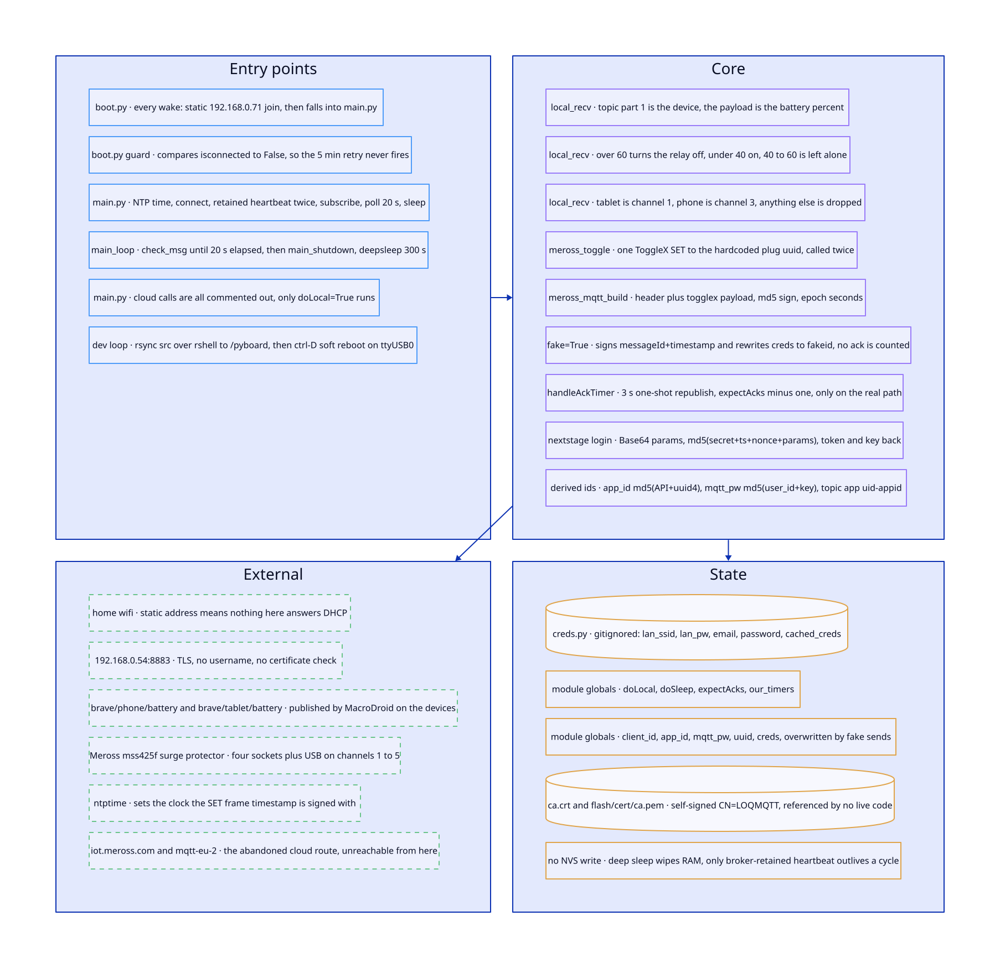

# esp32-mpython-meross — an ESP32 that reads your phone's battery off MQTT and switches a Meross plug

A 1 KB MicroPython program on an ESP32 that wakes every five minutes, listens to `brave/+/battery` for 20 seconds, and toggles a Meross surge-protector socket when the phone or tablet battery crosses 60 % or 40 %.

## Read it left to right

- **It is a polling duty cycle, not a daemon.** `boot.py` joins the WLAN with a hardcoded static address, `main.py` syncs NTP, connects to the broker, publishes a retained heartbeat *twice*, subscribes, then `main_loop` calls `check_msg` until 20 seconds have passed and `machine.deepsleep(300000)` ends the cycle. Nothing is written to flash: every wake starts from the same source files and the only proof the last cycle happened is the retained `brave/esp32/heartbeat` on the broker.
- **Two Meross paths exist; exactly one is alive.** `nextstage.py` still contains the full cloud client — Base64'd `mobileInfo`, `md5(secret + timestamp + nonce + params)`, `app_id = md5("API" + uuid4)`, `mqtt_pw = md5(user_id + key)` and the `/app/<uid>-<appid>/subscribe` topic — but every call site in `main.py` is commented out. The live path is a plain MQTT client to `192.168.0.54:8883` with `ssl=True` and `cert_reqs`/`ca_certs` commented out, so `ca.crt` and `flash/cert/ca.pem` (a self-signed `CN=LOQMQTT`, valid to 2027) are referenced by no live code and the TLS session is unauthenticated.
- **The battery rule is a two-threshold hysteresis.** `local_recv` takes the second topic segment as the device (`tablet` → channel 1, `phone` → channel 3, anything else is silently dropped) and `int()`s the payload; above 60 it sends off, below 40 it sends on, and 40–60 is deliberately left alone so a wobbling battery does not flap the relay. Each decision publishes the identical ToggleX frame twice, because the `fake=True` path never arms the ack timer that would otherwise re-send.
- **`fake=True` is a lie told to the frame, not just to the ack counter.** It signs with `messageId + timestamp` only (dropping `creds["key"]`) and mutates the module globals to `creds = {"user_id": "fakeid"}` / `app_id = "fakeappid"`, so the `from` header claims a fake app. The local bridge therefore cannot be checking the signature or the topic origin — and any real cloud call later in the same boot would inherit those overwritten globals.
- **Two small holes are load-bearing for debugging.** `boot.py` tests `wlan.isconnected == False` against the *method*, so the "retry in 5 minutes" deep-sleep never runs (and `machine` is not even imported there) — a failed join just falls through into `main.py`. Conversely, an exception before `main_loop` is caught, printed, and *not* slept, so a bad broker or a missing `creds.py` leaves the board awake and burning power instead of retrying in five minutes.

---

Diagram source: [`docs/system.d2`](docs/system.d2) · render with [`scripts/render-diagram.sh`](scripts/render-diagram.sh) (writes `docs/system.svg` for light and dark, plus `docs/system.png`).
